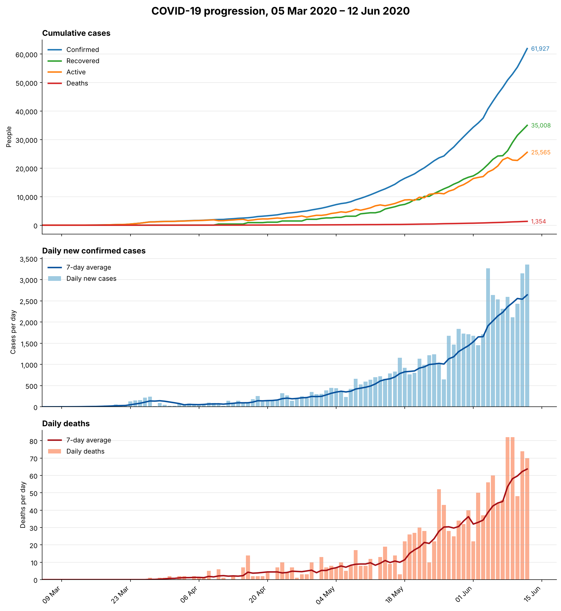

# covid-data-dashboard

Visualises daily COVID-19 data (5 Mar – 12 Jun 2020) as a three-panel chart:
cumulative totals, daily new cases and daily deaths, each with a 7-day average.



## Requirements

- Python 3.8 or newer
- `pandas` and `matplotlib`

## How to run

```
pip install pandas matplotlib
python visualise_covid.py "covid (1).json" covid_dashboard.png
```

The first argument is the input data file and the second is where the chart is saved.

## How it works

1. **Load and clean:** The JSON file is read with pandas. The numbers are stored as text with spaces as thousands separators (e.g. "61 927"), so these are stripped and converted to integers. Dates are converted to real date values.
2. **Smooth:** A 7-day rolling average is calculated for daily cases and daily deaths, which reduces day-to-day reporting noise.
3. **Plot:** matplotlib draws three stacked panels that share one date axis, then saves the result as a PNG.

## Findings

- Daily cases reach 3,359 on 12 June, the last day in the data.
- Deaths lag behind cases and peak at 82 on 8 June.
- Active cases stay below recovered cases after mid-May.
